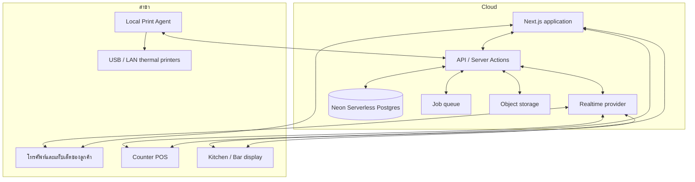

# POS@PRO — แบบออกแบบระบบ

เอกสารนี้กำหนดสถาปัตยกรรมสำหรับ Restaurant POS ที่รองรับหลายองค์กร หลายสาขา หลายจุดผลิต และการดูข้อมูลจากระยะไกลผ่านอินเทอร์เน็ต โดยใช้ Neon Serverless Postgres เป็นฐานข้อมูลหลัก ออกแบบให้เริ่มใช้กับร้านเดียวได้ และขยายโดยไม่ต้องเปลี่ยนแกนข้อมูล

## 1. ขอบเขตและหลักการออกแบบ

ระบบแบ่งเป็น 3 พื้นที่ใช้งาน แต่ใช้ฐานข้อมูลและกติกาธุรกิจชุดเดียวกัน

| พื้นที่ | ผู้ใช้ | หน้าที่ |
| --- | --- | --- |
| Customer Ordering | ลูกค้าที่สแกน QR | ดูเมนู สั่งอาหาร ติดตามออเดอร์ เรียกพนักงาน ขอเช็กบิล |
| Store Operations | แคชเชียร์ พนักงานเสิร์ฟ ครัว บาร์ ผู้จัดการ | เปิดโต๊ะ รับและผลิตออเดอร์ ชำระเงิน พิมพ์ และจัดการกะ |
| Back Office | เจ้าของร้าน ผู้จัดการ สต็อก และบัญชี | ตั้งค่าร้าน เมนู สิทธิ์ วัตถุดิบ ต้นทุน รายงาน และตรวจสอบย้อนหลัง |

หลักสำคัญ

- ทุกเรคคอร์ดทางธุรกิจผูกกับ `organizationId` และส่วนงานหน้าร้านผูกกับ `branchId` เสมอ เพื่อป้องกันข้อมูลข้ามร้านหรือข้ามสาขา
- เมนู หมวดหมู่ จุดผลิต และประเภทการชำระเงินเป็นข้อมูลที่ผู้ดูแลสร้างและปรับเองได้
- ระบบต้องใช้ได้บนอินเทอร์เน็ตและบันทึกข้อมูลไว้บนคลาวด์ แต่เครื่องภายในร้านต้องทนต่อการเชื่อมต่อที่สะดุดได้ในช่วงสั้น ๆ
- การขาย การตัดสต็อก การชำระเงิน และการพิมพ์ใช้เลขอ้างอิงและ audit log ที่แก้ไขย้อนหลังไม่ได้

## 2. ภาพรวมสถาปัตยกรรม



### เหตุผลของโครงสร้างนี้

`Next.js` เป็นเว็บหลักสำหรับ QR, Counter POS และ Back Office โดยใช้ App Router และ Node.js runtime เพื่อให้เชื่อมฐานข้อมูล งานพิมพ์ และ SDK ของผู้ให้บริการได้ครบถ้วน

`Neon Serverless Postgres` เป็นฐานข้อมูลหลัก เหมาะกับข้อมูลการขายที่ต้องการ transaction, การล็อกยอด, ความสัมพันธ์ระหว่างเอกสาร และการสรุปรายงาน โดยใช้ connection string แบบ pooled สำหรับ runtime ของเว็บแอป

`Realtime provider` ส่งเหตุการณ์ออเดอร์ใหม่ สถานะอาหาร การเรียกพนักงาน และสถานะโต๊ะให้จอทุกเครื่องทันที โดยไม่ให้หน้าจอต้อง polling ฐานข้อมูลถี่ ๆ

`Local Print Agent` เป็นโปรแกรมที่ติดตั้งในคอมพิวเตอร์ของแต่ละสาขาและเชื่อมต่อออกสู่ระบบคลาวด์เอง จึงไม่ต้องเปิดพอร์ตจากอินเทอร์เน็ตเข้าร้าน รองรับทั้งเครื่องพิมพ์ USB และ LAN และพิมพ์ ESC/POS แบบ raw ได้เสถียรกว่าการสั่งพิมพ์จาก browser

## 3. Multi-tenant และ Multi-branch

ลำดับความเป็นเจ้าของข้อมูลคือ

```text
Organization
  └── Brand (เลือกใช้เมื่อองค์กรมีหลายแบรนด์)
       └── Branch
            ├── Floor / Zone / Table
            ├── Production station
            ├── Printer and Print Agent
            ├── Inventory location
            └── Shift, order, payment, stock movement
```

เมนูกลางอยู่ระดับ Organization หรือ Brand ได้ แล้วสาขานำไปเปิดใช้ กำหนดราคา เปิด/ปิดขาย หรือแทนที่สูตรอาหารเฉพาะสาขาได้ โดยไม่ต้องคัดลอกเมนูทั้งชุด

ข้อมูลสำคัญทุก query ต้องกรองตามขอบเขตของผู้ใช้ เช่น ผู้จัดการสาขา A ไม่สามารถแก้เมนูหรืออ่านยอดขายของสาขา B ได้ แม้เดารหัส URL ถูก

## 4. ผู้ใช้ บทบาท และสิทธิ์

ผู้ใช้หนึ่งคนมีได้หลายบทบาทและหลายขอบเขต เช่น เจ้าของร้านเห็นทุกสาขา แต่ผู้จัดการเห็นเฉพาะบางสาขา

| บทบาทตัวอย่าง | สิทธิ์สำคัญ |
| --- | --- |
| Owner | จัดการองค์กร สาขา การเงิน ผู้ใช้ทั้งหมด และรายงานรวม |
| Admin | ตั้งค่าเมนู จุดผลิต เครื่องพิมพ์ และสิทธิ์ |
| Branch manager | ดูแลกะ อนุมัติส่วนลด ยกเลิก และปรับสต็อกในสาขา |
| Cashier | เปิดโต๊ะ รับออเดอร์ รับชำระเงิน และปิดบิล |
| Service staff | ดูโต๊ะ รับคำเรียก เพิ่มรายการ และยืนยันการเสิร์ฟ |
| Kitchen / Bar | รับใบงาน ยืนยันเริ่มทำและทำเสร็จ |
| Inventory staff | รับสินค้า ตรวจนับ โอน และบันทึกของเสีย |

สิทธิ์ควรเป็น permission เช่น `order.create`, `payment.refund`, `discount.approve`, `inventory.adjust`, `report.view.cost` แทนการตรวจชื่อบทบาทตรง ๆ เพื่อให้สร้างบทบาทใหม่ในอนาคตได้

ทุกคำสั่งที่มีผลต่อยอดเงินหรือสต็อกต้องตรวจสิทธิ์ใน server action หรือ API ไม่พึ่งการซ่อนปุ่มในหน้าเว็บ

## 5. Customer QR Ordering

### QR และ session โต๊ะ

QR แบบคงที่มีรหัสโต๊ะ แต่เมื่อเปิดโต๊ะ ระบบสร้าง `tableSession` และ signed access token ที่มีวันหมดอายุ ลูกค้าสแกนแล้วจะเข้าถึงเฉพาะ session ที่กำลังเปิดอยู่ เมื่อปิดบิล token เดิมต้องใช้สั่งอาหารไม่ได้

ระบบต้องไม่เก็บข้อมูลส่วนตัวลูกค้าโดยไม่จำเป็น ลูกค้าจึงสั่งได้โดยไม่ต้องสมัครสมาชิก แต่รองรับชื่อเรียกลูกค้า เบอร์โทร และสมาชิกเป็นข้อมูลเพิ่มเติมได้

### หน้าจอที่ตอบสนองตามอุปกรณ์

| เรื่อง | โทรศัพท์ | แท็บเล็ต |
| --- | --- | --- |
| การนำทาง | หมวดหมู่แนวนอน ตะกร้าแบบ bottom sheet | หมวดหมู่แถบซ้าย เมนูหลายคอลัมน์ ตะกร้าด้านขวา |
| รายละเอียดเมนู | modal เต็มหรือเกือบเต็มจอ | modal ขนาดกลางบนหน้าจอ |
| การยืนยันคำสั่ง | ปุ่ม sticky ด้านล่าง | แผงสรุปยอดคงที่ด้านข้าง |
| ความหนาแน่นข้อมูล | รูปและข้อความกระชับ | รูปอาหารใหญ่กว่า เห็นรายการพร้อมกันมากกว่า |

เป็นระบบเดียวกันและ URL เดียวกัน ใช้ CSS breakpoints กับ component ที่ปรับ layout เพื่อให้ธุรกิจและตะกร้าไม่ถูกแยกเป็นสองระบบ

### ความสามารถ

- หมวดหมู่และเมนูที่ร้านกำหนดเอง พร้อมรูป คำอธิบาย สถานะแนะนำ และสถานะหมด
- modifier เช่น ความหวาน ระดับเผ็ด เพิ่มท็อปปิ้ง หรือไม่ใส่วัตถุดิบ พร้อมกติกาเลือกขั้นต่ำ/สูงสุด
- ตะกร้าที่ยืนยันยอดและสร้าง order revision ป้องกันการส่งซ้ำเมื่อเครือข่ายสะดุด
- หน้ารายการที่สั่งและสถานะต่อรายการ
- เรียกพนักงานด้วยประเภทคำขอที่ร้านกำหนดได้ และมีสถานะรับเรื่อง/เสร็จสิ้น
- ขอเช็กบิล โดยคำขอถูกส่งไปยัง Counter POS และพนักงานเสิร์ฟทันที

## 6. Counter POS และวงจรชีวิตของโต๊ะ

Counter POS ต้องมีแผนผังโต๊ะและมุมมองรายการค้างทำ สถานะโต๊ะที่แนะนำคือ `AVAILABLE`, `OCCUPIED`, `ORDERING`, `WAITING_FOOD`, `CHECK_REQUESTED`, `PAYMENT_IN_PROGRESS`, `CLOSED`

ขั้นตอนมาตรฐาน

1. แคชเชียร์หรือพนักงานเปิด `tableSession` พร้อมจำนวนลูกค้า
2. ระบบเปิด QR ให้ลูกค้า หรือพนักงานเพิ่มรายการแทนลูกค้า
3. การยืนยันรายการสร้าง order และแยกรายการเข้าจุดผลิต
4. ครัว/บาร์อัปเดตสถานะ การเสิร์ฟอัปเดตสถานะเสิร์ฟ
5. ลูกค้าหรือพนักงานขอเช็กบิล ระบบคำนวณยอด final
6. รับชำระเงินได้หลายรายการต่อบิล เช่น เงินสด 200 บาท + QR 350 บาท
7. เมื่อยอดชำระครบ ระบบปิด bill และ table session พร้อมยกเลิก QR token

การย้ายโต๊ะ รวมโต๊ะ แยกบิล ลดราคา ยกเลิกรายการ และคืนเงินเป็น use case ต้องออกแบบตั้งแต่ต้น เพราะส่งผลต่อยอดขาย สต็อก และการตรวจสอบย้อนหลัง

กฎสำคัญ: บิลที่ปิดแล้วห้ามแก้ยอดโดยตรง การแก้หลังปิดใช้เอกสารคืนเงินหรือ adjustment ที่อ้างอิงบิลเดิมเสมอ

## 7. ออเดอร์ ครัว บาร์ และ KDS

แต่ละ `productionStation` ผู้ดูแลสร้างได้ไม่จำกัดและกำหนดชนิด เช่น Kitchen, Grill, Bar, Dessert, Packing

เมนูหนึ่งรายการ route ได้มากกว่าหนึ่งจุดผลิต เช่น set menu ส่งอาหารไปครัวและเครื่องดื่มไปบาร์ โดย route เก็บไว้ระดับ `menuItem` หรือ `modifier` ตามความจำเป็น

สถานะของ `orderItem` คือ `NEW`, `ACKNOWLEDGED`, `PREPARING`, `READY`, `SERVED`, `CANCELLED` และเวลาในแต่ละสถานะใช้วัดเวลารออาหารและประสิทธิภาพจุดผลิตได้

KDS ต้องมีลำดับความสำคัญ เวลาเตือนรายการใกล้เกิน SLA การจัดกลุ่มตามโต๊ะ/ใบงาน และปุ่มรับงาน เริ่มทำ พร้อมเสิร์ฟ

## 8. ระบบพิมพ์ความร้อน

### ข้อมูลที่ตั้งค่าได้

- Print Agent: ระบุเครื่องคอมพิวเตอร์ในสาขาและ API key เฉพาะเครื่อง
- Printer: ชื่อเครื่อง รูปแบบ USB/LAN, IP และ port ของ LAN, ขนาดกระดาษ 58/80 mm, code page และสถานะ
- Print template: ใบครัว ใบบาร์ ใบเสร็จ ใบยกเลิก ใบเปิดกะ และใบสรุปกะ
- Print routing rule: เหตุการณ์ใด รายการประเภทใด หรือจุดผลิตใด ส่งไปเครื่องพิมพ์ใด

### ลำดับการพิมพ์

1. ธุรกรรม commit สำเร็จก่อน
2. ระบบสร้าง `printJob` แบบ immutable ใน transaction เดียวกัน หรือผ่าน outbox event
3. Print Agent ดึงงานของสาขาตน ส่งคำสั่ง ESC/POS ไปยังเครื่องพิมพ์ และตอบผลกลับ
4. งานพิมพ์มีสถานะ `QUEUED`, `SENT`, `PRINTED`, `FAILED`, `RETRYING` และพิมพ์ซ้ำได้โดยบันทึกเหตุผล

แนวทางนี้ป้องกันกรณีขายสำเร็จแต่ใบครัวไม่ออก และยังแสดงงานพิมพ์ที่ล้มเหลวให้พนักงานดำเนินการได้

## 9. การชำระเงิน

ตาราง `paymentMethod` เป็นค่าตั้งระดับองค์กรหรือสาขา จึงเพิ่มประเภทได้ เช่น CASH, TRANSFER, CARD, PROMPTPAY_QR, E_WALLET, VOUCHER, HOUSE_ACCOUNT และ OTHER

`payment` เก็บยอด รับจริง เงินทอน reference จากผู้ให้บริการ เวลา ผู้รับเงิน และสถานะ `PENDING`, `SUCCEEDED`, `FAILED`, `VOIDED`, `REFUNDED`

ระบบต้องรองรับ

- ชำระเต็มจำนวน จ่ายหลายวิธี และแบ่งยอดตามผู้ร่วมโต๊ะ
- ส่วนลดทั้งบิลและรายรายการ พร้อม policy ผู้อนุมัติ
- service charge, ภาษีแบบ inclusive/exclusive, rounding และเงินทอนที่กำหนดต่อสาขา
- การเชื่อม payment gateway ภายหลังผ่าน adapter เพื่อไม่ผูก business logic กับผู้ให้บริการรายใดรายหนึ่ง
- การคืนเงิน โดยเก็บผู้อนุมัติ เหตุผล และการอ้างอิงการชำระเงินเดิม

## 10. สต็อก สูตรอาหาร และต้นทุน

### โครงสร้าง

`ingredient` เป็น master วัตถุดิบ, `unit` เป็นหน่วยนับ, `recipe` เชื่อมเมนูกับวัตถุดิบ, `inventoryLocation` เป็นคลังหรือจุดเก็บในแต่ละสาขา, และ `stockMovement` เป็น ledger ที่ห้ามแก้ย้อนหลัง

ประเภทความเคลื่อนไหว ได้แก่ PURCHASE_RECEIPT, ORDER_CONSUMPTION, WASTE, COUNT_ADJUSTMENT, TRANSFER_OUT, TRANSFER_IN, RETURN_TO_VENDOR และ PRODUCTION

### กติกา

- สูตรหนึ่งเมนูรองรับวัตถุดิบหลายตัว หน่วยแปลงได้ เช่น กิโลกรัมเป็นกรัม
- ตัดสต็อกตามสูตรเมื่อยืนยันออเดอร์ หรือเมื่อเริ่มผลิต โดยตั้งค่าได้ต่อสาขา
- เมนูที่ไม่มีสูตรยังขายได้ แต่รายงานต้นทุนต้องระบุว่าเป็นต้นทุนไม่ครบ
- ใช้ moving weighted average เป็นวิธีต้นทุนเริ่มต้น เพราะเหมาะกับร้านอาหารและทำความเข้าใจง่าย; สามารถเพิ่ม FIFO ในอนาคตได้
- การตรวจนับไม่แก้ยอดคงเหลือโดยตรง แต่สร้าง COUNT_ADJUSTMENT เพื่อเห็นส่วนต่างและผู้รับผิดชอบ
- การยกเลิกรายการต้องสร้าง movement กลับเฉพาะเมื่อวัตถุดิบยังไม่ถูกผลิตหรือมี policy ให้คืนสต็อก

## 11. ข้อมูลและตารางหลัก

ตารางสำคัญที่ควรมีใน schema รุ่นแรก

```text
organizations, brands, branches, branch_settings
users, roles, permissions, user_role_assignments, audit_logs
floors, zones, tables, table_sessions, qr_access_tokens
menu_categories, menu_items, menu_variants, modifier_groups, modifier_options
production_stations, menu_item_station_routes
orders, order_items, order_item_modifiers, kitchen_tickets
bills, bill_items, payments, payment_methods, discounts, refunds
service_requests, shifts, cash_drawer_events
print_agents, printers, print_routing_rules, print_jobs
ingredients, units, unit_conversions, recipes, recipe_items
inventory_locations, stock_movements, purchase_receipts, stock_counts, waste_records
notifications, outbox_events
```

ทุกตารางที่เปลี่ยนแปลงโดยผู้ใช้ควรมี `createdAt`, `updatedAt`, `createdBy` และข้อมูลทางการเงินควรมี immutable journal หรือ audit record เพิ่มเติม

## 12. ความถูกต้องของธุรกรรมและการทำงานเรียลไทม์

การกดสั่งอาหารหรือรับชำระเงินต้องส่ง `idempotencyKey` จาก client เพื่อป้องกันการสร้างรายการซ้ำเมื่อผู้ใช้กดสองครั้งหรือเน็ตตัดแล้วส่งซ้ำ

คำสั่งที่เกี่ยวกับยอดเงินต้องใช้ database transaction เช่น สร้าง payment, อัปเดตยอดชำระ bill, สร้าง cash drawer event และ outbox event ให้สำเร็จหรือยกเลิกพร้อมกัน

หลัง commit แล้ว worker ส่ง event ไป Realtime และจัดคิว print job ไม่ส่ง event ก่อน transaction สำเร็จ

หน้าจอ POS และ KDS เก็บ event cursor ล่าสุดไว้ เมื่อเชื่อมต่อใหม่ต้องดึงรายการที่เปลี่ยนหลัง cursor แทนการเชื่อว่าการเชื่อมต่อสดไม่เคยหลุด

## 13. การทำงานเมื่อเน็ตมีปัญหา

เป้าหมายหลักคือข้อมูลอยู่คลาวด์และเจ้าของร้านตรวจสอบจากระยะไกลได้ จึงไม่ควรทำ local database แบบอิสระที่ merge ยากตั้งแต่รุ่นแรก

สิ่งที่ต้องรองรับในรุ่นแรก

- PWA cache ไฟล์หน้าเมนูและเมนูที่เปิดอยู่ล่าสุด
- แสดงสถานะ online/offline ชัดเจนในจอ Counter POS และ QR
- เก็บคำสั่งที่ยังส่งไม่สำเร็จใน encrypted local queue พร้อม idempotency key แล้ว sync เมื่อออนไลน์
- ห้ามยืนยันว่าชำระเงินสำเร็จจนกว่าจะได้รับคำตอบจาก server; หากขาดการเชื่อมต่อให้แสดงสถานะ pending และห้ามปิดโต๊ะอัตโนมัติ
- Print Agent คงงานที่ดึงแล้วใน local queue และ retry เมื่อเครื่องพิมพ์หรือเน็ตกลับมา

เมื่อธุรกิจต้องการขายต่อได้หลายชั่วโมงโดยไม่มีอินเทอร์เน็ต ค่อยเพิ่ม Branch Edge Server ที่มี PostgreSQL ในร้านและระบบ sync แบบ event log เป็นระยะถัดไป เพราะมีความซับซ้อนด้าน conflict และการเงินสูง

## 14. โครงสร้าง Next.js ที่แนะนำ

```text
src/
  app/
    (public)/q/[branchSlug]/[tableCode]/page.tsx
    (auth)/login/page.tsx
    (pos)/pos/[branchId]/page.tsx
    (kds)/kds/[branchId]/[stationId]/page.tsx
    (backoffice)/dashboard/page.tsx
    (backoffice)/settings/menu/page.tsx
    (backoffice)/inventory/page.tsx
    api/
      v1/print-agents/[agentId]/jobs/route.ts
      v1/webhooks/[provider]/route.ts
      v1/realtime/sync/route.ts
  features/
    orders, payments, menu, inventory, printing, authorization
  components/
  lib/
    db, auth, realtime, validation, money, tenancy
  server/
    actions, services, repositories, jobs
```

- หน้า dashboard ที่อ่านข้อมูลใช้ Server Components เพื่ออ่านฐานข้อมูลโดยตรง
- การแก้ข้อมูลจากหน้าเว็บใช้ Server Actions พร้อม validation และ permission check
- Route Handlers ใช้สำหรับ Print Agent, webhooks, realtime sync และ external/mobile API เท่านั้น
- หน้าจอ POS, KDS และ QR Cart เป็น Client Components เฉพาะส่วนที่ต้องโต้ตอบและรับ realtime event
- ทุก route ทำงานบน Node.js runtime เป็นค่าเริ่มต้น ไม่ใช้ Edge runtime เพราะต้องรองรับ database driver, queue และ integrations

## 15. ชุดเทคโนโลยีที่แนะนำ

| ความรับผิดชอบ | ตัวเลือกเริ่มต้น |
| --- | --- |
| Web application | Next.js App Router + TypeScript |
| UI | Tailwind CSS + shadcn/ui + responsive component ของระบบเอง |
| ฐานข้อมูล | Neon Serverless Postgres + Prisma ORM |
| Authentication | Auth.js หรือ Better Auth พร้อม session ที่ปลอดภัย |
| Validation | Zod |
| Realtime | Ably, Pusher หรือ Supabase Realtime; เลือกหนึ่งตัวตามงบและการ deploy |
| Background jobs | BullMQ + Redis หรือ managed queue |
| Object storage | S3-compatible storage สำหรับรูปเมนูและเอกสาร |
| Monitoring | structured logs, error tracking และ audit log |
| Local printing | Node.js Print Agent สำหรับ Windows พร้อม ESC/POS adapter |

Neon เป็นผู้ให้บริการฐานข้อมูลที่กำหนดแล้ว ส่วนผู้ให้บริการ deploy แอป, realtime, queue และ object storage เลือกได้ภายหลังโดยไม่เปลี่ยน schema หรือกติกาทางธุรกิจ

## 16. การตั้งค่า Neon สำหรับ POS@PRO

### โครงสร้าง environment

แยก Neon project สำหรับ production ออกจาก development/staging เพื่อไม่ให้ข้อมูลการขายจริงปะปนกับข้อมูลทดสอบ ภายใน project ที่ไม่ใช่ production ใช้ Neon branch สำหรับงาน feature, pull request และทดสอบ migration ได้

```text
Neon production project
  └── production branch / production compute

Neon non-production project
  ├── main development branch
  ├── staging branch
  └── preview branches ต่อ pull request
```

### Connection และ ORM

- เก็บ pooled Neon connection string ไว้ใน `DATABASE_URL` เฉพาะ environment ฝั่ง server; ห้ามใช้ `NEXT_PUBLIC_` หรือส่ง URL นี้ไป browser
- ใช้ Prisma ORM และ Prisma migrations เพื่อให้ schema, relation และ transaction ของเอกสารการขายมี type safety และตรวจสอบได้ใน source control
- Runtime Next.js ใช้ pooled endpoint เพื่อรับ concurrent requests จาก QR, POS และ KDS โดยไม่เปิด database connection เกินจำเป็น
- Migration เป็นงาน CI/CD ที่ควบคุมได้และใช้สิทธิ์แยกจาก runtime; ต้องไม่รัน migration อัตโนมัติจากทุก instance ของเว็บแอป
- ใช้ role แยกอย่างน้อย `pos_app` สำหรับแอป และ `pos_migrator` สำหรับ migration โดย runtime role ไม่มีสิทธิ์เปลี่ยน schema

### Performance และความต่อเนื่อง

- เลือก Neon region และ region สำหรับ application/realtime ให้อยู่ใกล้กันก่อน แล้วพิจารณาระยะห่างจากสาขาหลัก เพื่อจำกัด latency ตอนสร้างออเดอร์และชำระเงิน
- สาขาที่เปิดขายต่อเนื่องควรใช้ production compute ที่ไม่ scale to zero ในเวลาทำการ หรือเลือกค่า compute ที่ทำให้การตื่นจาก idle ไม่กระทบหน้าเคาน์เตอร์
- เก็บคำสั่งซื้อและยอดชำระเงินใน short transaction เสมอ หลีกเลี่ยง transaction ที่รอ input ผู้ใช้หรือการพิมพ์
- สร้าง index จาก query จริงตั้งแต่รุ่นแรก เช่น `(organization_id, branch_id, status, created_at)` สำหรับ order, `(branch_id, table_session_id)` สำหรับโต๊ะ และ `(branch_id, occurred_at)` สำหรับรายงาน

### การกู้คืนและการเปลี่ยนแปลง schema

- ใช้ Neon branch และ point-in-time restore เพื่อสร้างพื้นที่ตรวจสอบก่อนกู้ข้อมูล ห้าม restore production ทันทีโดยไม่ตรวจสอบ branch ที่คืนค่าแล้ว
- ทำ backup export ของข้อมูลการเงินตามรอบที่ตกลงกันเพิ่มอีกชั้นหนึ่ง และทดสอบขั้นตอนกู้คืนก่อนเปิดร้านจริง
- Migration ทุกตัวต้องมีรหัสเวอร์ชัน อยู่ใน repository และทดสอบกับ branch ที่มีข้อมูลจำลองก่อนนำขึ้น production

## 17. API และเหตุการณ์สำคัญ

ตัวอย่างคำสั่งภายในระบบ

```text
POST /api/v1/orders                 create order (idempotency key required)
POST /api/v1/orders/:id/items       append order item
POST /api/v1/order-items/:id/status update kitchen status
POST /api/v1/bills/:id/payments     create payment
POST /api/v1/tables/:id/open        open table session
POST /api/v1/tables/:id/close       close table after payment validation
POST /api/v1/service-requests       request staff
GET  /api/v1/print-agents/:id/jobs  agent claims its next job
POST /api/v1/print-jobs/:id/result  report success or failure
```

เหตุการณ์ realtime เช่น `order.created`, `order.item.updated`, `table.updated`, `service_request.created`, `bill.check_requested`, `print_job.failed`, `inventory.low_stock` ต้องมี organization และ branch scope ชัดเจนก่อนเผยแพร่ให้ client

## 18. ความปลอดภัยและการตรวจสอบย้อนหลัง

- แยก tenant และ branch ใน data-access layer ทุกครั้ง ห้ามเชื่อ `organizationId` ที่ส่งมาจาก browser โดยไม่ตรวจ session
- QR token เป็น signed, มีอายุ, ผูกกับ table session และ revoke ได้
- เก็บรหัสผ่านด้วย algorithm มาตรฐาน และรองรับ PIN สั้นเฉพาะการล็อกอินหน้าเคาน์เตอร์ได้
- เข้ารหัส secrets ของ Print Agent และไม่เก็บเลขบัตรเครดิตหรือข้อมูลชำระเงินอ่อนไหวเอง
- จำกัดอัตราการเรียก QR ordering และ login เพื่อป้องกัน abuse
- Audit log ต้องบันทึก actor, branch, action, record, ค่าเดิม/ใหม่ที่เหมาะสม, เหตุผล และเวลา
- Backups ฐานข้อมูลรายวัน พร้อมทดสอบการกู้คืนเป็นระยะ

## 19. ลำดับการพัฒนา

### Milestone 1 — ทำให้ขายได้

1. โครง Next.js, authentication, organization/branch/role และ PostgreSQL schema
2. หลังบ้านจัดการโต๊ะ หมวดหมู่ เมนู ตัวเลือก และจุดผลิต
3. QR Ordering แบบ responsive พร้อมตะกร้าและสร้างออเดอร์
4. Counter POS, แผนผังโต๊ะ, รับออเดอร์, คิดเงินหลายวิธี และปิดโต๊ะ
5. KDS และ Print Agent/print job สำหรับครัว บาร์ และใบเสร็จ
6. Realtime, audit log และรายงานยอดขายพื้นฐาน

### Milestone 2 — ควบคุมร้าน

1. ส่วนลด อนุมัติ ยกเลิก คืนเงิน แยกบิล รวมโต๊ะ และปิดกะ
2. สูตรอาหาร วัตถุดิบ รับสินค้า ตัดสต็อก และตรวจนับ
3. รายงานต้นทุน กำไรขั้นต้น ของเสีย และ low-stock alert
4. PWA queue และหน้าจอ recovery เมื่อเน็ตหรือเครื่องพิมพ์ขัดข้อง

### Milestone 3 — ขยายธุรกิจ

1. หลายแบรนด์ หลายสาขา ราคา/เมนูเฉพาะสาขา และรายงานรวม
2. สมาชิก คูปอง สั่งล่วงหน้า ระบบเดลิเวอรี และ payment gateway
3. Branch Edge Server สำหรับร้านที่ต้องทำงานออฟไลน์นาน

## 20. เกณฑ์ผ่านของรุ่นแรก

- เจ้าของสร้างสาขา โต๊ะ หมวดหมู่ เมนู จุดผลิต และชนิดรับชำระเงินเองได้
- ลูกค้าสแกน QR แล้วสั่งอาหารจากโทรศัพท์หรือแท็บเล็ตได้ และรายการถึงครัว/บาร์ทันที
- แคชเชียร์เปิดโต๊ะ รับรายการ เพิ่มรายการแทนลูกค้า รับหลายการชำระเงิน และปิดบิลได้
- หน้าครัวเห็นงานและเปลี่ยนสถานะจนลูกค้า/พนักงานเห็นการอัปเดต
- งานพิมพ์ถูกส่งไปยังเครื่อง USB/LAN ที่ตั้งค่าไว้ โดยมี retry และ log เมื่อพิมพ์ไม่สำเร็จ
- ผู้จัดการและเจ้าของดูยอดขายย้อนหลังตามสาขา พร้อมตรวจสอบผู้ทำรายการสำคัญได้
- สาขาหนึ่งไม่สามารถเห็นหรือแก้ไขข้อมูลของสาขาอื่นโดยไม่มีสิทธิ์
